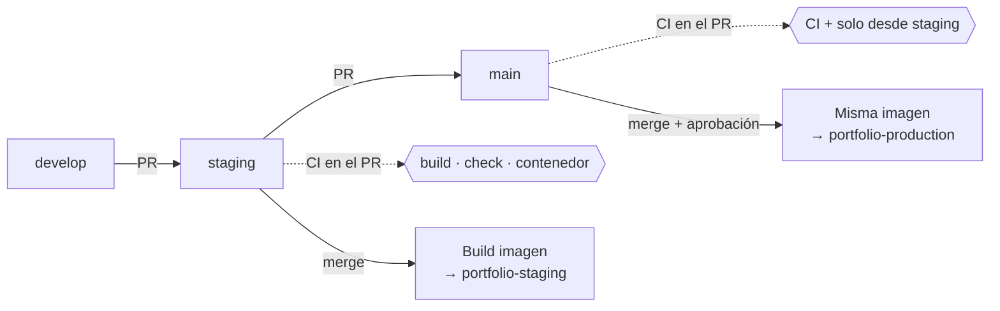

# 🚀 Guía de deploy — Portfolio en Google Cloud Run

> Cómo el portfolio pasa de `develop` a producción: contenedor con nginx, infraestructura con **Terraform** y CI/CD con **GitHub Actions**.

| | |
|---|---|
| **Repo** | `gonemvaz012/portfolio-web-2026` |
| **Ramas** | `develop` → `staging` → `main` (producción) |
| **Hosting** | Cloud Run · `portfolio-staging` y `portfolio-production` |
| **Región sugerida** | `us-central1` |

## Índice

1. [Conceptos clave](#1-conceptos-clave)
2. [Cómo funciona el flujo](#2-cómo-funciona-el-flujo)
3. [Requisitos (una sola vez)](#3-requisitos-una-sola-vez)
4. [Contenedor del sitio](#4-contenedor-del-sitio)
5. [Infraestructura con Terraform](#5-infraestructura-con-terraform)
6. [Configuración en GitHub](#6-configuración-en-github)
7. [Workflows de GitHub Actions](#7-workflows-de-github-actions)
8. [El día a día](#8-el-día-a-día)
9. [Rollback](#9-rollback)
10. [Preguntas frecuentes](#10-preguntas-frecuentes)
11. [Glosario](#11-glosario)
12. [Checklist](#12-checklist)

---

## 1. Conceptos clave

| Pieza | Qué hace | Cuándo corre |
|---|---|---|
| 🐳 **Docker** | Empaqueta el sitio (build de Astro + nginx) en una imagen | En cada deploy |
| 🏗️ **Terraform** | Crea la infraestructura en GCP: servicios, registro, cuentas, permisos | Cada tanto, cuando cambia la infraestructura |
| ⚙️ **GitHub Actions** | CI: testea cada PR. CD: construye y despliega | En cada PR y en cada merge |
| ☁️ **Cloud Run** | Corre el contenedor, escala a cero y da una URL HTTPS | Siempre |

> [!TIP]
> **Terraform arma la cancha, el CI/CD juega cada partido.** No se reemplazan: se complementan.

> [!NOTE]
> **Cloud Run no es solo para APIs.** Corre cualquier contenedor que responda HTTP. El portfolio es estático, así que nginx lo sirve desde un contenedor.
>
> **¿Y Cloud Build?** Es el CI propio de GCP, con sus propios *triggers*. Usamos GitHub Actions porque los checks que aprueban o bloquean un PR se integran solos en GitHub.

---

## 2. Cómo funciona el flujo



1. **PR `develop` → `staging`**: corre el CI. Si falla, GitHub bloquea el merge.
2. **Merge a `staging`**: se construye la imagen, se sube a Artifact Registry y se despliega en `portfolio-staging`.
3. **PR `staging` → `main`**: es el "trigger" a producción.
4. **Merge a `main`** y tu aprobación en el environment `production`: se despliega **la misma imagen** que se probó en staging, sin recompilar.

> [!IMPORTANT]
> **¿Cómo sabe producción cuál es "la misma imagen"?**
> Cada imagen se etiqueta con el **hash del árbol de archivos**: `tree-$(git rev-parse HEAD^{tree})`. El merge a `main` crea un commit nuevo con contenido idéntico, así que el hash del árbol coincide. Si esa imagen no existe, el código no pasó por staging y el deploy falla **a propósito**.

> [!NOTE]
> La rama `production` sobra: `main` es producción.
> ```sh
> git push origin --delete production && git branch -D production
> ```

---

## 3. Requisitos (una sola vez)

- [ ] **Proyecto de GCP** con facturación activada. Anotá el **Project ID**.
- [ ] **Alerta de presupuesto**: Billing → Budgets, por ejemplo de USD 5.
- [ ] **gcloud CLI** → <https://cloud.google.com/sdk/docs/install#deb>
- [ ] **Terraform** → <https://developer.hashicorp.com/terraform/install> (repo apt de HashiCorp)
- [ ] **Docker Desktop** con integración WSL, para probar el contenedor localmente.

```sh
gcloud auth login
gcloud auth application-default login   # credenciales que usa Terraform
gcloud config set project TU_PROJECT_ID
```

> [!TIP]
> **Región:** `us-central1` tiene la cuota gratuita más amplia y soporta *domain mapping*. `southamerica-east1` (São Paulo) queda más cerca, pero es más cara y no soporta domain mapping. Para un sitio estático, la diferencia de latencia casi no se nota.

---

## 4. Contenedor del sitio

### `Dockerfile`

Build en dos etapas: Node compila Astro y nginx sirve `dist/` en el puerto **8080**, que es el que espera Cloud Run.

```dockerfile
FROM node:22.23.4-alpine AS build
WORKDIR /app
COPY package*.json ./
RUN npm ci
COPY . .
RUN npm run build

FROM nginxinc/nginx-unprivileged:1.27-alpine
COPY nginx.conf /etc/nginx/conf.d/default.conf
COPY --from=build /app/dist /usr/share/nginx/html
EXPOSE 8080
```

### `nginx.conf`

```nginx
server {
  listen 8080;
  root /usr/share/nginx/html;
  gzip on;
  gzip_types text/css application/javascript image/svg+xml;

  # Astro pone hash en los nombres de /_astro: se pueden cachear para siempre
  location /_astro/ {
    add_header Cache-Control "public, max-age=31536000, immutable";
  }
  location / {
    add_header Cache-Control "no-cache";
    try_files $uri $uri/ =404;
  }
}
```

### `.dockerignore`

```
node_modules
dist
.astro
.git
portfolio-gonzalo.html
```

> [!IMPORTANT]
> La versión de Node está **fijada** (`22.23.4`), no como `22`. Astro exige `>=22.23.4`, y una etiqueta genérica como `node:22-alpine` puede apuntar a una versión vieja que quedó guardada en tu máquina. Con la versión exacta, el build da el mismo resultado en tu máquina y en el CI. Si actualizás Astro y pide un Node más nuevo, subí este número.

### Probar localmente

```sh
docker build -t portfolio .              # construye la imagen y la llama "portfolio"
docker run --rm -p 8080:8080 portfolio   # crea un contenedor a partir de esa imagen
# → http://localhost:8080
```

| Parte | Significado |
|---|---|
| `-t portfolio` | *tag*: el nombre de la imagen. Es arbitrario; sin él, la imagen solo se identifica por un hash |
| `.` | El *contexto*: la carpeta con el `Dockerfile` y los archivos a copiar |
| `--rm` | Borra el contenedor cuando lo frenás |
| `-p 8080:8080` | `puerto_de_tu_máquina:puerto_del_contenedor` |
| `portfolio` (al final) | Qué imagen usar para crear el contenedor |

---

## 5. Infraestructura con Terraform

### 5.1 Bucket para el *state*

Terraform guarda en el **state** lo que ya creó. El bucket que lo guarda se crea a mano, porque Terraform lo necesita antes de poder arrancar.

```sh
gcloud storage buckets create gs://TU_PROJECT_ID-tfstate \
  --location=us-central1 --uniform-bucket-level-access
gcloud storage buckets update gs://TU_PROJECT_ID-tfstate --versioning
```

Para verificar que quedó creado:

```sh
gcloud storage buckets list --format="table(name, location, versioning_enabled)"
gcloud storage buckets describe gs://TU_PROJECT_ID-tfstate --format="yaml(name, location, versioning_enabled)"
```

Después del primer `terraform init` + `apply`, el state aparece adentro:

```sh
gcloud storage ls gs://TU_PROJECT_ID-tfstate/portfolio/   # → default.tfstate
```

### 5.2 Qué se crea

```
infra/
├── main.tf            # recursos
├── variables.tf       # parámetros
├── outputs.tf         # valores para cargar en GitHub
└── terraform.tfvars   # tu Project ID (no se sube a git)
```

| Recurso | Para qué |
|---|---|
| `google_project_service` | Habilita las APIs (Run, Artifact Registry, IAM, STS) |
| `google_artifact_registry_repository` | Guarda las imágenes y limpia las viejas |
| `google_service_account.runtime` | Identidad del sitio, sin permisos |
| `google_cloud_run_v2_service` ×2 | `portfolio-staging` y `portfolio-production` |
| `google_cloud_run_v2_service_iam_member` | Sitio público (`allUsers`) |
| `google_service_account.deployer` | Identidad de GitHub Actions |
| Workload Identity Pool + Provider | Acceso de GitHub sin claves, restringido a tu repo |

### `infra/main.tf`

```hcl
terraform {
  required_providers {
    google = { source = "hashicorp/google", version = ">= 6.0" }
  }
  backend "gcs" {
    bucket = "TU_PROJECT_ID-tfstate"
    prefix = "portfolio"
  }
}

provider "google" {
  project = var.project_id
  region  = var.region
}

locals {
  environments = toset(["staging", "production"])
}

# APIs que hay que habilitar en el proyecto
resource "google_project_service" "apis" {
  for_each = toset([
    "run.googleapis.com",
    "artifactregistry.googleapis.com",
    "iam.googleapis.com",
    "iamcredentials.googleapis.com",
    "sts.googleapis.com",
  ])
  service            = each.value
  disable_on_destroy = false
}

# Registro donde se guardan las imágenes Docker
resource "google_artifact_registry_repository" "images" {
  repository_id = "portfolio"
  location      = var.region
  format        = "DOCKER"

  cleanup_policies {
    id     = "keep-recent"
    action = "KEEP"
    most_recent_versions { keep_count = 10 }
  }
  cleanup_policies {
    id     = "delete-old"
    action = "DELETE"
    condition { older_than = "2592000s" } # 30 días
  }
  depends_on = [google_project_service.apis]
}

# Identidad con la que corre el sitio (sin permisos: solo sirve archivos)
resource "google_service_account" "runtime" {
  account_id   = "portfolio-runtime"
  display_name = "Portfolio (Cloud Run)"
}

# Un servicio de Cloud Run por ambiente
resource "google_cloud_run_v2_service" "site" {
  for_each            = local.environments
  name                = "portfolio-${each.key}"
  location            = var.region
  ingress             = "INGRESS_TRAFFIC_ALL"
  deletion_protection = false

  template {
    service_account = google_service_account.runtime.email
    scaling {
      min_instance_count = 0
      max_instance_count = 2
    }
    containers {
      # Imagen provisoria: a partir del primer deploy la reemplaza el CI
      image = "us-docker.pkg.dev/cloudrun/container/hello"
      ports { container_port = 8080 }
      resources {
        limits   = { cpu = "1", memory = "256Mi" }
        cpu_idle = true
      }
    }
  }

  # El CI cambia la imagen en cada deploy; Terraform no tiene que revertirla
  lifecycle {
    ignore_changes = [template[0].containers[0].image, client, client_version]
  }
  depends_on = [google_project_service.apis]
}

# Sitio público: cualquiera puede visitarlo
resource "google_cloud_run_v2_service_iam_member" "public" {
  for_each = local.environments
  name     = google_cloud_run_v2_service.site[each.key].name
  location = var.region
  role     = "roles/run.invoker"
  member   = "allUsers"
}

# --- Acceso de GitHub Actions sin claves (Workload Identity Federation) ---

resource "google_service_account" "deployer" {
  account_id   = "github-deployer"
  display_name = "GitHub Actions deployer"
}

resource "google_project_iam_member" "deployer" {
  for_each = toset(["roles/run.developer", "roles/artifactregistry.writer"])
  project  = var.project_id
  role     = each.value
  member   = "serviceAccount:${google_service_account.deployer.email}"
}

# El deployer puede desplegar servicios que corren como "runtime"
resource "google_service_account_iam_member" "deployer_acts_as_runtime" {
  service_account_id = google_service_account.runtime.name
  role               = "roles/iam.serviceAccountUser"
  member             = "serviceAccount:${google_service_account.deployer.email}"
}

resource "google_iam_workload_identity_pool" "github" {
  workload_identity_pool_id = "github"
  depends_on                = [google_project_service.apis]
}

resource "google_iam_workload_identity_pool_provider" "github" {
  workload_identity_pool_id          = google_iam_workload_identity_pool.github.workload_identity_pool_id
  workload_identity_pool_provider_id = "github"
  attribute_mapping = {
    "google.subject"       = "assertion.sub"
    "attribute.repository" = "assertion.repository"
  }
  # Solo tu repo puede usar esta puerta
  attribute_condition = "assertion.repository == \"${var.github_repo}\""
  oidc { issuer_uri = "https://token.actions.githubusercontent.com" }
}

resource "google_service_account_iam_member" "github_impersonates_deployer" {
  service_account_id = google_service_account.deployer.name
  role               = "roles/iam.workloadIdentityUser"
  member             = "principalSet://iam.googleapis.com/${google_iam_workload_identity_pool.github.name}/attribute.repository/${var.github_repo}"
}
```

> [!WARNING]
> En el bloque `backend "gcs"` hay que escribir **el nombre real del bucket**, por ejemplo `porfolio-web-513914-tfstate`. Ese bloque **no acepta variables** ni toma valores de `terraform.tfvars`, porque Terraform lo lee antes que todo lo demás. Si queda `TU_PROJECT_ID-tfstate`, `terraform init` falla con *"bucket doesn't exist"*.

### `infra/variables.tf`

```hcl
variable "project_id" { type = string }

variable "region" {
  type    = string
  default = "us-central1"
}

variable "github_repo" {
  type    = string
  default = "gonemvaz012/portfolio-web-2026"
}
```

### `infra/outputs.tf`

```hcl
output "wif_provider" { value = google_iam_workload_identity_pool_provider.github.name }
output "deployer_sa"  { value = google_service_account.deployer.email }
output "urls"         { value = { for k, s in google_cloud_run_v2_service.site : k => s.uri } }
```

### `infra/terraform.tfvars`

```hcl
project_id = "TU_PROJECT_ID"
```

> [!WARNING]
> Agregá al `.gitignore`: `infra/terraform.tfvars`, `infra/.terraform/` y `*.tfstate*`.

### 5.3 Aplicar

```sh
cd infra
terraform init      # descarga el provider y se conecta al bucket del state
terraform plan      # muestra QUÉ va a crear, sin tocar nada
terraform apply     # lo crea (confirmás con "yes")
terraform output    # anotá wif_provider, deployer_sa y urls
```

| Comando | Qué hace |
|---|---|
| `terraform init` | Prepara la carpeta: providers y backend |
| `terraform fmt` | Formatea los `.tf` |
| `terraform validate` | Revisa la sintaxis |
| `terraform plan` | Muestra la diferencia entre el código y lo que existe |
| `terraform apply` | Aplica esa diferencia |
| `terraform destroy` | Borra todo lo que creó ⚠️ |

> [!NOTE]
> **Workload Identity Federation (WIF)** reemplaza a la vieja clave JSON guardada en los secrets de GitHub. GitHub le presenta a GCP un token firmado que dice *"soy un workflow del repo gonemvaz012/portfolio-web-2026"*. GCP lo verifica y le da permisos temporales de `github-deployer`. **No hay ninguna clave que se pueda filtrar.**

---

## 6. Configuración en GitHub

### 6.1 Variables

**Settings → Secrets and variables → Actions → pestaña Variables.** No hace falta que sean secrets: con WIF no son sensibles.

| Variable | Valor |
|---|---|
| `GCP_PROJECT_ID` | tu Project ID |
| `GCP_REGION` | `us-central1` |
| `WIF_PROVIDER` | output `wif_provider` → `projects/123…/locations/global/workloadIdentityPools/github/providers/github` |
| `DEPLOYER_SA` | output `deployer_sa` |

### 6.2 Environments

**Settings → Environments**: creá `staging` y `production`. En `production` configurá:

- **Required reviewers**: vos.
- **Deployment branches**: solo `main`.

> [!CAUTION]
> **Este repo es privado y usa el plan Free.** Ahí GitHub no ofrece *required reviewers* (la sección *Deployment protection rules* no aparece) y **no aplica los rulesets**.
>
> | | Privado Free (este repo) | Público o Pro |
> |---|---|---|
> | El CI corre en cada PR | ✅ | ✅ |
> | Los deploys automáticos funcionan | ✅ | ✅ |
> | Un CI en rojo **bloquea** el botón de merge | ❌ lo ves, pero podés mergear igual | ✅ |
> | Aprobación extra antes de producción | ❌ el merge `staging → main` es tu aprobación | ✅ |
>
> **Regla práctica: no mergear un PR con el check en rojo.** Aunque mergees por error, los deploys tienen sus propias barreras: si el build falla no se despliega nada, y producción solo acepta imágenes que pasaron por staging.

### 6.3 Reglas de ramas

**Settings → Rules → Rulesets**: un ruleset para `staging` y otro para `main`.

- [x] Require a pull request before merging
- [x] Require status checks to pass → `CI / build` (en `main`, también `CI / source-branch`)
- [x] Block force pushes

> [!TIP]
> Los checks aparecen en la lista recién después de que el CI corrió al menos una vez. Abrí un PR de prueba primero.

> [!NOTE]
> **Opcional: este repo no los usa.** En un repo privado con plan Free, GitHub pide un upgrade para configurarlos. No son necesarios: el CI y los deploys funcionan igual, y lo único que agregan es bloquear el botón de merge. Si algún día el repo pasa a público o a Pro, se pueden configurar sin cambiar nada más.

---

## 7. Workflows de GitHub Actions

```
.github/workflows/
├── ci.yml                  # PR → staging / main
├── deploy-staging.yml      # push a staging
└── deploy-production.yml   # push a main (+ aprobación)
```

> [!NOTE]
> Revisá en el Marketplace la última versión mayor de cada acción (`actions/checkout`, `google-github-actions/auth`, etc.).

### `ci.yml`: testea cada PR

```yaml
name: CI
on:
  pull_request:
    branches: [staging, main]

jobs:
  build:
    runs-on: ubuntu-latest
    steps:
      - uses: actions/checkout@v7
      - uses: actions/setup-node@v7
        with: { node-version: 22, cache: npm }
      - run: npm ci
      - run: npx astro check
      - run: npm run build

      # "Test de deploy": se construye el contenedor real, se levanta y se prueba
      - run: docker build -t portfolio:test .
      - run: docker run -d -p 8080:8080 --name site portfolio:test
      - name: Smoke test
        run: |
          for i in $(seq 1 10); do curl -fs http://localhost:8080/ > page.html && break; sleep 1; done
          grep -q "Gonzalo Vazquez" page.html
          ASSET=$(grep -o '/_astro/[^"]*\.css' page.html | head -1)
          curl -fsI "http://localhost:8080$ASSET"

  source-branch:
    runs-on: ubuntu-latest
    steps:
      - name: A main solo se llega desde staging
        if: github.base_ref == 'main' && github.head_ref != 'staging'
        run: echo "Los PRs a main tienen que venir de staging" && exit 1
      - run: echo ok
```

### `deploy-staging.yml`: construye y despliega

```yaml
name: Deploy staging
on:
  push:
    branches: [staging]

permissions:
  contents: read
  id-token: write   # necesario para Workload Identity Federation

concurrency: deploy-staging

jobs:
  deploy:
    runs-on: ubuntu-latest
    environment: staging
    env:
      IMAGE: ${{ vars.GCP_REGION }}-docker.pkg.dev/${{ vars.GCP_PROJECT_ID }}/portfolio/site
    steps:
      - uses: actions/checkout@v7
      - uses: google-github-actions/auth@v3
        with:
          workload_identity_provider: ${{ vars.WIF_PROVIDER }}
          service_account: ${{ vars.DEPLOYER_SA }}
      - uses: google-github-actions/setup-gcloud@v3
      - run: gcloud auth configure-docker ${{ vars.GCP_REGION }}-docker.pkg.dev --quiet

      - name: Build y push
        run: |
          TAG=tree-$(git rev-parse HEAD^{tree})
          docker build -t $IMAGE:$TAG .
          docker push $IMAGE:$TAG
          echo "TAG=$TAG" >> $GITHUB_ENV

      - name: Deploy
        run: |
          gcloud run deploy portfolio-staging --image $IMAGE:$TAG \
            --region ${{ vars.GCP_REGION }} --quiet

      - name: Smoke test contra staging
        run: |
          URL=$(gcloud run services describe portfolio-staging --region ${{ vars.GCP_REGION }} --format='value(status.url)')
          curl -fs "$URL" | grep -q "Gonzalo Vazquez"
          echo "### Staging: $URL" >> $GITHUB_STEP_SUMMARY
```

### `deploy-production.yml`: promueve la imagen probada

```yaml
name: Deploy production
on:
  push:
    branches: [main]
  workflow_dispatch: {}   # botón "Run workflow" para re-desplegar a mano

permissions:
  contents: read
  id-token: write

concurrency: deploy-production

jobs:
  deploy:
    runs-on: ubuntu-latest
    environment: production   # solo desde main (configurado en el environment)
    env:
      IMAGE: ${{ vars.GCP_REGION }}-docker.pkg.dev/${{ vars.GCP_PROJECT_ID }}/portfolio/site
    steps:
      - uses: actions/checkout@v7
      - uses: google-github-actions/auth@v3
        with:
          workload_identity_provider: ${{ vars.WIF_PROVIDER }}
          service_account: ${{ vars.DEPLOYER_SA }}
      - uses: google-github-actions/setup-gcloud@v3

      - name: Buscar la imagen probada en staging
        run: |
          TAG=tree-$(git rev-parse HEAD^{tree})
          gcloud artifacts docker images describe $IMAGE:$TAG > /dev/null \
            || { echo "::error::Esta versión no pasó por staging ($TAG)"; exit 1; }
          echo "TAG=$TAG" >> $GITHUB_ENV

      - name: Deploy
        run: |
          gcloud run deploy portfolio-production --image $IMAGE:$TAG \
            --region ${{ vars.GCP_REGION }} --quiet

      - name: Smoke test contra producción
        run: |
          URL=$(gcloud run services describe portfolio-production --region ${{ vars.GCP_REGION }} --format='value(status.url)')
          curl -fs "$URL" | grep -q "Gonzalo Vazquez"
          echo "### Producción: $URL" >> $GITHUB_STEP_SUMMARY
```

---

## 8. El día a día

```sh
git checkout develop
# ...cambios...
git commit -am "Actualiza experiencia" && git push
```

| Paso | Dónde | Qué pasa |
|---|---|---|
| 1 | GitHub | PR `develop → staging` → corre el CI → si está en verde, merge |
| 2 | Automático | Build + deploy a **staging** |
| 3 | Navegador | Revisás la URL de staging |
| 4 | GitHub | PR `staging → main` → merge |
| 5 | Actions | "Deploy production" espera → **Review deployments → Approve** |
| 6 | Automático | La misma imagen se despliega en **producción** |

> [!TIP]
> Después de mergear a `main`, actualizá `develop` para que no quede atrás:
> ```sh
> git checkout develop && git pull origin main && git push
> ```

---

## 9. Rollback

Cloud Run guarda cada deploy como una **revisión** inmutable. Volver atrás es mover el tráfico:

```sh
gcloud run revisions list --service portfolio-production --region us-central1
gcloud run services update-traffic portfolio-production \
  --to-revisions=NOMBRE_REVISION=100 --region us-central1
```

También desde la consola: **Cloud Run → servicio → Revisiones → Administrar tráfico**.

> [!WARNING]
> El rollback no cambia el código de `main`. Arreglá el problema en `develop` y hacé que pase por el flujo normal. Si no, el próximo deploy vuelve a subir el error.

---

## 10. Preguntas frecuentes

<details>
<summary><strong>¿Por qué no docker-compose?</strong></summary>

Compose sirve para **orquestar varios contenedores localmente**: app + base de datos + Redis, con sus redes, volúmenes y el orden de arranque. Acá hay **una sola imagen** sin dependencias, así que `docker build` + `docker run` alcanzan. Un `compose.yaml` solo agregaría un archivo más.

Además, Cloud Run **no usa compose para desplegar**: despliega una imagen por servicio. Compose sería solo una comodidad para desarrollo local.

**Cuándo conviene sumarlo:** el día que agregues, por ejemplo, una API en FastAPI con PostgreSQL, para levantar todo junto en tu máquina con `docker compose up`. En la nube, cada pieza va a su servicio: la API en otro Cloud Run y la base en Cloud SQL.
</details>

<details>
<summary><strong>¿Qué es un bucket y por qué lo necesita Terraform?</strong></summary>

Un **bucket** es un contenedor de archivos en **Google Cloud Storage**, como una carpeta en la nube (`gs://bucket/carpeta/archivo`). Es el equivalente a S3 en AWS.

Terraform anota en el **state** (`terraform.tfstate`) qué recursos reales corresponden a cada bloque del código. En cada `plan` compara tres cosas:

1. **El código** (`.tf`): lo que querés que exista.
2. **El state**: lo que Terraform cree que creó.
3. **GCP real**: lo que existe de verdad.

Con eso calcula qué crear, modificar o borrar. **Si perdés el state, Terraform olvida lo que creó**: intentaría crear todo de nuevo y fallaría con "ya existe", o habría que reimportar cada recurso a mano.

**Por qué en un bucket y no en tu máquina:**

| Archivo local | Bucket |
|---|---|
| Se pierde si se rompe la máquina | Vive en la nube |
| Subirlo a git lo expone (puede tener datos sensibles) | Fuera del repo, con acceso por IAM |
| No está disponible desde otra máquina o un CI | Cualquiera con permiso lo lee del mismo lugar |
| Dos `apply` a la vez pueden corromperlo | Terraform lo **bloquea** (*lock*) mientras trabaja |
| Un cambio malo lo deja inservible | Con *versioning*, se recupera una versión anterior |

**Por qué se crea a mano:** Terraform necesita el bucket *antes* de arrancar para guardar su memoria, así que no puede crearlo él mismo. Es el *bootstrap*: lo creás una sola vez con `gcloud` y después Terraform maneja todo lo demás. La conexión está en el bloque `backend "gcs"` de `main.tf`, y `terraform init` es el comando que la establece.
</details>

<details>
<summary><strong>¿Por qué no correr Terraform desde el CI?</strong></summary>

Se puede: `terraform plan` en el PR y `apply` al mergear. Pero la infraestructura de este proyecto casi no cambia, y darle al CI permisos para modificar IAM agrega riesgo. Correrlo a mano es más simple y más seguro. Si algún día cambia seguido, se agrega un workflow para eso.
</details>

<details>
<summary><strong>¿Cuánto cuesta?</strong></summary>

Con el tráfico de un portfolio, casi nada. Cloud Run tiene cuota gratuita mensual (millones de requests) y escala a cero cuando nadie visita el sitio. Artifact Registry cobra el almacenamiento por encima de una cuota gratuita chica; la política de limpieza deja solo las imágenes recientes. La alerta de presupuesto te avisa si algo se dispara.
</details>

<details>
<summary><strong>¿Y un dominio propio?</strong></summary>

Lo más simple es **Cloud Run → Administrar dominios personalizados**, para lo que conviene `us-central1`. La alternativa robusta es un Load Balancer con certificado administrado, pero cuesta unos USD 18 por mes.
</details>

<details>
<summary><strong>El primer arranque tarda un poco, ¿es normal?</strong></summary>

Sí, es el *cold start*: con `min_instance_count = 0`, la primera visita después de un rato sin tráfico levanta el contenedor. Con nginx son unos cientos de milisegundos. Con `min_instance_count = 1` desaparece, pero pasás a pagar una instancia siempre encendida.
</details>

---

## 11. Glosario

| Término | Qué es |
|---|---|
| **Imagen / contenedor** | La imagen es la app empaquetada; el contenedor es esa imagen corriendo |
| **Artifact Registry** | El depósito de imágenes de GCP |
| **Servicio / revisión** | `portfolio-staging` es un servicio; cada deploy crea una revisión inmutable |
| **CI** | Integración continua: verificar cada cambio automáticamente |
| **CD** | Despliegue continuo: desplegar automáticamente lo que pasó el CI |
| **IaC** | Infraestructura como código, por ejemplo Terraform |
| **State** | Registro de lo que creó Terraform; vive en el bucket |
| **Service account** | Una identidad para máquinas, con permisos propios |
| **WIF** | Permite que GitHub actúe como una service account sin claves guardadas |
| **Environment** | Ambiente de GitHub con reglas propias: aprobaciones, ramas permitidas |
| **Promoción** | Llevar a producción el mismo artefacto probado en staging |
| **Smoke test** | Prueba mínima de que algo levanta y responde |
| **Cold start** | Demora de la primera petición cuando no hay instancias encendidas |

---

## 12. Checklist

**GCP**
- [ ] Proyecto creado, facturación activa y alerta de presupuesto
- [ ] `gcloud` y `terraform` instalados y autenticados
- [ ] Bucket del state creado
- [ ] `terraform apply` sin errores; outputs anotados

**Repo**
- [ ] `Dockerfile`, `nginx.conf` y `.dockerignore`
- [ ] `infra/` con `main.tf`, `variables.tf` y `outputs.tf`
- [ ] `.gitignore` con `terraform.tfvars`, `.terraform/` y `*.tfstate*`
- [ ] `.github/workflows/` con los 3 workflows
- [ ] Rama `production` borrada

**GitHub**
- [ ] Variables `GCP_PROJECT_ID`, `GCP_REGION`, `WIF_PROVIDER` y `DEPLOYER_SA`
- [ ] Environments `staging` y `production` (con reviewer)
- [ ] *(Opcional, requiere repo público o Pro)* Rulesets en `staging` y `main` con los checks requeridos

**Primera vuelta**
- [ ] PR `develop → staging` → CI en verde → merge → staging desplegado
- [ ] PR `staging → main` → merge → aprobación → producción desplegada
